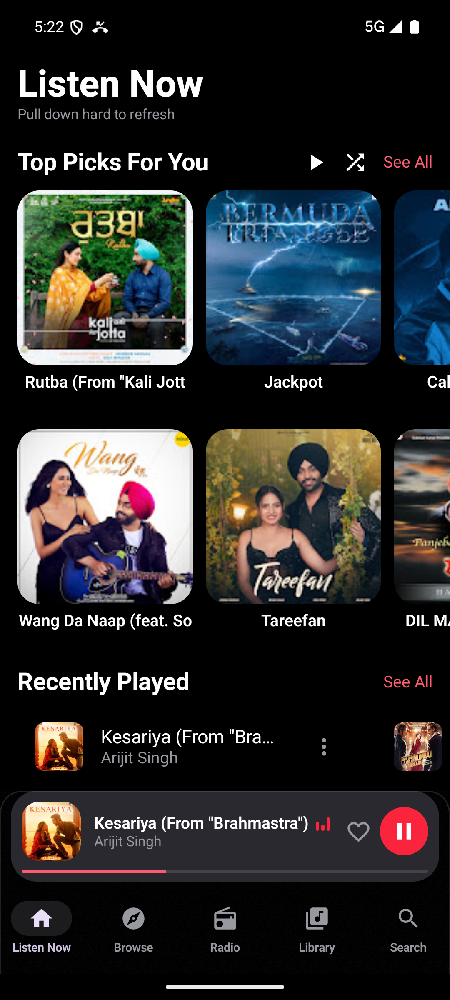
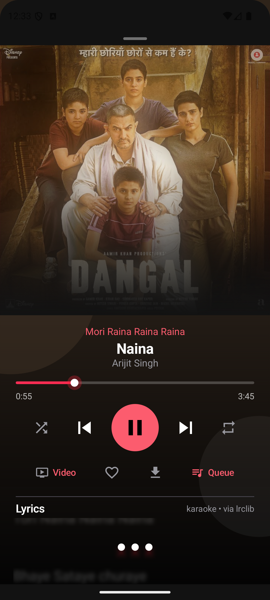
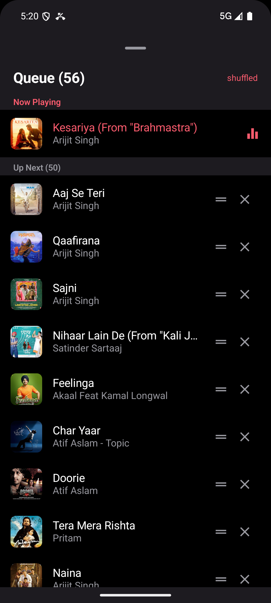
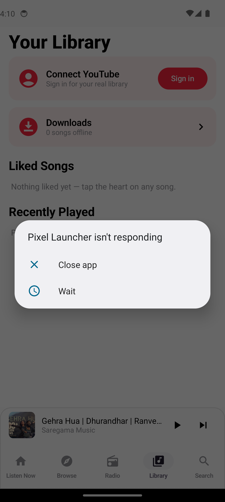
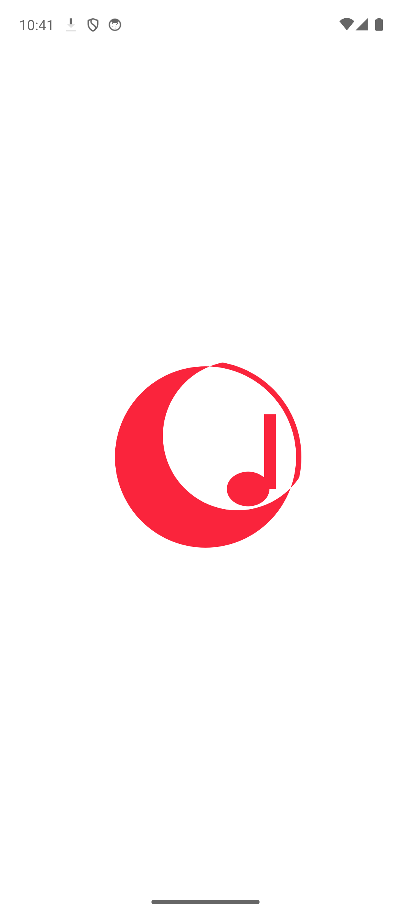

<picture>
  <source media="(prefers-color-scheme: dark)" srcset="cresca-flutter/assets/logo_dark.png" />
  
</picture>

# Cresca Music

> **Cresca**, from *crescendo*: music that keeps growing. Your music, flowing.


Cresca is a free, Apple Music styled music player for Android, powered by live
YouTube data. Search millions of songs, stream instantly, sing along with
synced karaoke lyrics, build playlists, download for offline listening, and
sign in with your YouTube session. Everything stays on your device: no
account, no analytics, no server.

## What it is

Cresca has two generations in this repo. The stable app today is the native
Kotlin player under `app/`. A full Flutter rewrite lives under
`cresca-flutter/` (version `1.5.1+21`, see
[cresca-flutter/pubspec.yaml](cresca-flutter/pubspec.yaml)) and is where
active development happens, including a podcasts tab and a Spotify import
flow. See [RESTRUCTURE.md](RESTRUCTURE.md) for the port plan and
[CHANGELOG.md](CHANGELOG.md) for release history.

## Features

Every item below exists in the code. Nothing here is a roadmap wish.

- **Listen Now home.** Taste matched Top Picks from your recent plays,
  charts, new releases, mood tiles, endless discovery rails,
  pull to refresh. (code: `HomeFeed.kt`, `lib/core/home_feed.dart`)
- **Real YouTube audio.** Search plus signature deciphered streams, gapless
  queue playback, smart shuffle, repeat, and a multi GB predictive cache so
  skips start instantly.
- **Vibe queue.** Up Next is matched to the song mood through YouTube related
  data, with same name clones, one singer loops, mixes, and hour long uploads
  filtered out.
- **Full player.** Edge to edge artwork melted into a blurred backdrop,
  rolling lyric ticker, glowing seek bar, credits card, and a menu with
  share, playlist, queue, and download actions.
- **Karaoke lyrics.** Synced highlighting with tap to seek, multi source
  lookup (YouTube captions, LRCLIB, KuGou, lyrics.ovh), gap dots on long
  breaks, and manual scroll that pauses auto scroll.
- **Music videos.** Embedded player driven by the music transport, 1080p
  DASH adaptive with quality picker, fullscreen landscape, next video
  prefetch.
- **Playlists and library.** Liked Songs, Recently Played, custom playlists
  with rename and gallery covers, smart suggestions from playlist artists,
  favorite artists strip.
- **Downloads and offline.** Files saved as `Artist - Title`, in app folder
  or device Music folder, offline first playback, clean delete.
- **Podcasts (Flutter build).** Show subscriptions, episode search, resume
  from saved position, playback speed and sleep timer, download for offline.
  (code: `cresca-flutter/lib/podcasts/`, `podcast_screen.dart`)
- **Spotify import.** One tap login with PKCE, background import with resume,
  periodic mirror sync.
- **Calls just work.** Pause on call, resume after, mid call taps park safely
  and never crash.
- **System integration.** Media notification with Next, Prev, and Like,
  lockscreen controls, background playback service, Live Updates progress
  chip on supported Android versions.
- **YouTube login.** In app sign in, session stored encrypted on device,
  sign out wipes everything.
- **In app updates.** Daily GitHub release check with banner and
  notification, live download progress, tap to install.
- **Look and feel.** Light, dark, and system themes, Cresca red, liquid glass
  bars, animated splash and intro, optional motion kill switch.

Full detail: [docs/FEATURES.md](docs/FEATURES.md). Group listening:
[docs/JAM.md](docs/JAM.md) and [docs/jam-advance-mode.md](docs/jam-advance-mode.md).

## Download and install

**Android:** grab the APK for your device from
[Releases](https://github.com/ritz0007/Cresca/releases). Copy it to your
phone, tap it, allow "Install unknown apps" when asked. Requires Android 8.0
or newer.

| Device | File |
|---|---|
| Modern phones (Pixel, Galaxy S series, most 2020 plus phones) | `Cresca-*arm64.apk` |
| Older 32 bit phones | `Cresca-*armv7.apk` |
| Emulators, Chromebooks | `Cresca-*x86_64.apk` |
| Not sure | `Cresca-*universal.apk` (works everywhere, bigger download) |

**iOS:** there is no TestFlight or App Store build yet. The Flutter project
in this repo ships Android only (no `ios/` folder), and the stopgap is a
minimal single file Swift player you build yourself on a Mac with Xcode and
sideload to your iPhone. Honest status and steps:
[ios-sideload/README-IOS.md](ios-sideload/README-IOS.md).

## Screenshots

Shots from the Android app:

| Home | Full player |
|---|---|
|  |  |

| Up Next queue | Library |
|---|---|
|  |  |

| Splash |
|---|
|  |

Search and podcast screens are not pictured yet. New captures will be added
as the Flutter UI lands.

## Tech stack

- **Stable app:** Kotlin, Jetpack Compose UI, ExoPlayer with Media3 session,
  foreground playback service, EncryptedSharedPreferences session store.
- **Flutter rewrite (`cresca-flutter/`):** `just_audio` plus `audio_service`
  for playback, `youtube_explode_dart` and InnerTube clients for data,
  `video_player` for music videos, `background_downloader` for offline files,
  `webview_flutter` for YouTube sign in, `flutter_secure_storage` for the
  session, `flutter_local_notifications` for updater and progress notes.
- **Lyrics:** LRCLIB, KuGou, and lyrics.ovh lookup with LRC, VTT, SRT, and
  timedtext parsing plus translation and romanization helpers.
- **Tests:** 14 test files under `cresca-flutter/test` (queue, lyrics,
  downloads, podcasts, JAM, updates, and more), last reported at 138 green.

## Project structure

```text
app/                  Native Kotlin player (stable, ships today)
cresca-flutter/       Flutter rewrite (active development)
  lib/app/            Screens, player, library, downloads, updates
  lib/audio/          Playback controller and service glue
  lib/auth/           YouTube session, Spotify PKCE
  lib/core/           Queue engine, discovery, home feed, motion
  lib/data/           Repository, InnerTube, lyrics, cache
  lib/jam/            Group listening protocol, client, session
  lib/podcasts/       Shows, episodes, store, playback support
  lib/system/         Live Updates, permissions
  test/               Dart and Flutter test suites
docs/                 FEATURES, JAM guides, screenshots in docs/img
ios-sideload/         Minimal Swift player plus sideload guide
jam-server/           Companion jam server experiments
phases/               Build phases and release checklist
```

## Build from source

You need Flutter (3.13 plus per `pubspec.yaml`) and the Android SDK.

```bash
cd cresca-flutter
flutter pub get
flutter analyze
flutter test
flutter build apk --split-per-abi
```

Per ABI APKs land under `build/app/outputs/flutter-apk/`. For a single file
that installs anywhere, use `flutter build apk` without the split flag. The
native Kotlin app still builds with Gradle (`:app:testDebugUnitTest`,
`assembleDebug`) until Phase 5 archives it; see
[phases/production-readiness-checklist.md](phases/production-readiness-checklist.md)
for the release gates (signing, application ID, version bump).

## Testing

```bash
cd cresca-flutter
flutter test
```

This runs the full suite: queue engine, discovery scoring, home feed,
lyrics parsing and scoring, downloads, session restore, live updates,
podcasts, JAM protocol, and update checks. Please keep new behavior covered
and keep `flutter analyze` clean.

## Permissions and privacy

The on device ethos is the point. Your login cookies live in encrypted
storage, your likes, playlists, recents, and downloads never leave the
phone, clearing app data wipes everything, and the app reports nothing
anywhere. GitHub release download counts are public on the release page;
that is the only telemetry of any kind, and it comes from GitHub, not the
app.

Declared Android permissions are limited to what playback needs: internet,
foreground service with media playback, and notifications (for player and
updater status on Android 13 plus). Runtime permission prompts appear where
the OS requires them.

Full policy: [PRIVACY.md](PRIVACY.md).

## Contributing

Bug reports, ideas, and pull requests are welcome.

- **Found a bug.** Open an issue with your device, Android version, app
  version (Settings, About), and steps to reproduce. A crash log
  (Settings, Share crash log) helps a lot.
- **Want a feature.** Open an issue first so scope can be agreed before code.
- **Want to code.** Fork, create a topic branch, keep changes focused,
  add or extend tests, verify `flutter analyze`, `flutter test`, and a real
  device or emulator run, then open a PR against `main`. Never commit logs,
  `build/` output, or APKs (APKs ship through Releases only).

## License

There is no `LICENSE` file in this repo yet, so the code is all rights
reserved by default. If you want to reuse or redistribute Cresca, open an
issue to ask. A formal license choice is still to do.

## Acknowledgements

Thanks to the services and packages Cresca stands on: LRCLIB and lyrics.ovh
for synced lyrics, KuGou for an extra lyrics leg, the Invidious project for
the iOS stopgap stream path, and the Flutter community packages
(`just_audio`, `audio_service`, `youtube_explode_dart`, `video_player`,
`background_downloader`, `webview_flutter`) that power the rewrite. YouTube
and Spotify belong to their owners; Cresca is an independent player, not
affiliated with either.
